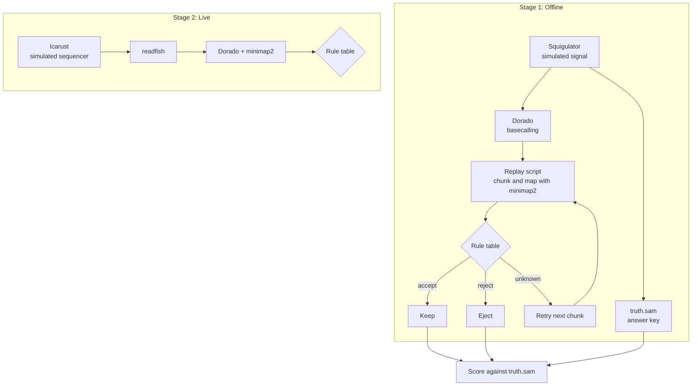

# Nanopore-Sequencing-Project

Nanopore sequencing is a technique where nucleic acids are processed in real time through a nanopore that is set in an electrically resistant membrane within a flow cell Every time a molecule goes through one of the nanopores, this disrupts the ionic current and produces raw signals which are sent to the basecaller(algorithm that translates the raw signal to the actual DNA/RNA sequence) to produce long reads of the DNA/RNA sequences. 

One of the main concerns that this project aims to focus on for nanopore sequencing is the accuracy of the sequences it produces and the speed per read. Readfish is a package that was developed to make adaptive sampling more practical for large genomes where it was designed to make the decision loop work and be configurable. However, it was not made to be decision optimal since it uses a hand set rule table. Every time a read is put in the unknown category, the read will wait until it is run in the next chunk and be retried again with fixed rules. This project will see whether predicting how those reads will resolve might potential let the pipeline decide earlier and reduce time. 

## Research Question
Does predicting whether unknown reads will resolve reduce the time needed to produce long reads compared to normal adaptive sampling method with the additional unknown category method?

## Project Format

The project will implement two pipelines:
- Pipeline #1 will use adaptive sampling(accept/reject decisions) with the addition unknown category using the Readfish package. The Readfish package will repeat unknown reads in the next chunk of data (with the idea that the mapper improves with each new chunk) until the unknown read reaches a decision (accept/reject).
- Pipeline #2 will use the same decision categories along with the Readfish package, but after a read is categorized as unknown, we will predict how many more chunks it will need to resolve (or to get a decision of accept or reject). If an unknown read is predicted to not resolve, then the read will be rejected. If not, then the read will proceed to the next chunk.

Benchmark Evaluation:

## Pipeline #1

This pipeline uses the following tools: Squigulator, Minimap2, Icarust, Dorado, and Readfish. Below is the framework of the pipeline:



### Setting up the environment:
---
This pipeline uses the conda env named nanopore which contains the squigulator and minimap2 packages and samtools:

```
conda activate nanopore
```

go into the project directory:
```
cd ~/nanopore_project
```

create a shell variable for the Dorado package
```
find ~ -type f -name dorado 2>/dev/null
DORADO=<path>
```

### Starting a session
---

The first step to the pipeline is creating the raw signal data file through squigulator. The simulator expects the device type, the reference genome file, the output file, and the number of reads. 

*The testing portion of the pipeline will use the E. coli genome and since the device has to match Dorado, we will use r10.4.1. In the testing stage, only 20 reads will be used. The file truth.sam will be used to check whether an accepted read was on target since it holds the exact position of where the reads go. 

Types of possible devices:
- dna-r9-min: genomic DNA on MinION R9.4.1 flowcells
- dna-r9-prom: genomic DNA on PromethION R9.4.1 flowcells
- rna-r9-min: direct RNA on MinION R9.4.1 flowcells
- rna-r9-prom: direct RNA on PromethION R9.4.1 flowcells
- dna-r10-min: genomic DNA on MinION R10.4.1 flowcells
- dna-r10-prom: genomic DNA on PromethION R10.4.1 flowcells
- rna004-min: direct RNA on MinION RNA004 flowcells
- rna004-prom: direct RNA on promethION RNA004 flowcells

```
squigulator -x [OPTIONS] ref_genome.fa -o reads.blow5 -n NUM_READS -c truth.paf
```

Ex:
```
squigulator -x dna-r10-prom --ont-friendly yes genomes/GCF_000005845.2_ASM584v2_genomic.fna -o reads.blow5 -n 20 -c truth.paf -q truth.sam
```

---
Building the answer key:
```
samtools fastq truth.sam 2>/dev/null > true_reads.fastq
```
```
minimap2 -ax map-ont genomes/ecoli.fna true_reads.fastq > truth_aligned.sam
```
```
samtools view -F 260 truth_aligned.sam 2>/dev/null | head -n 2 | cut -f1-6
```

---
Dorado only reads POD5 files, so you need to convert your output to POD5.
```
blue-crab s2p reads.blow5 -o reads.pod5
```

check if the file is correct
```
pod5 inspect reads reads.pod5
pod5 inspect summary reads.pod5
```

Basecaller:

The Dorado basecaller will take that POD5 file as input and fetch the fast model. 
```
$DORADO basecaller fast reads.pod5 > reads.bam
samtools view -c reads.bam
```

Fastq

```
samtools fastq reads.bam > reads.fastq
head -n 2 reads.fastq
head -n 2 truth.paf
```

mapper:

```
minimap2 -ax map-ont genomes/ecoli.fna reads.fastq > mapped.sam
samtools view -c -F 260 mapped.sam
```

check results:

Create a script file called compare.sh
```
nano compare.sh
```

This file will check whether the reads from the pipeline match the positions from the answer key. It wwill output how apart the reads are from its correct position in the genome.

```
#!/bin/bash 

samtools view -F 260 mapped.sam 2>/dev/null | cut -f1,4 | LC_ALL=C sort > mapped_pos.txt 

samtools view -F 260 truth_aligned.sam 2>/dev/null | cut -f1,4 | LC_ALL=C sort > truth_pos.txt 

LC_ALL=C join -t $'\t' mapped_pos.txt truth_pos.txt | awk -F'\t' '{d=$2-$3; if(d<0)d=-d; print $1, $2, $3, "diff="d}' 
```
